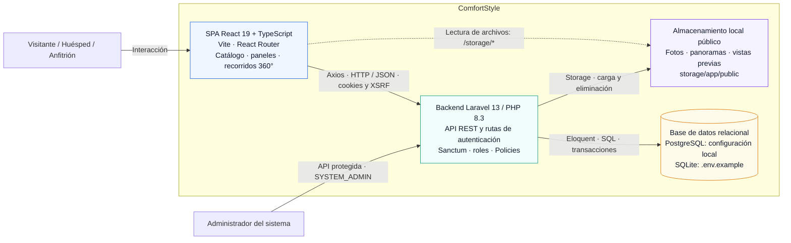
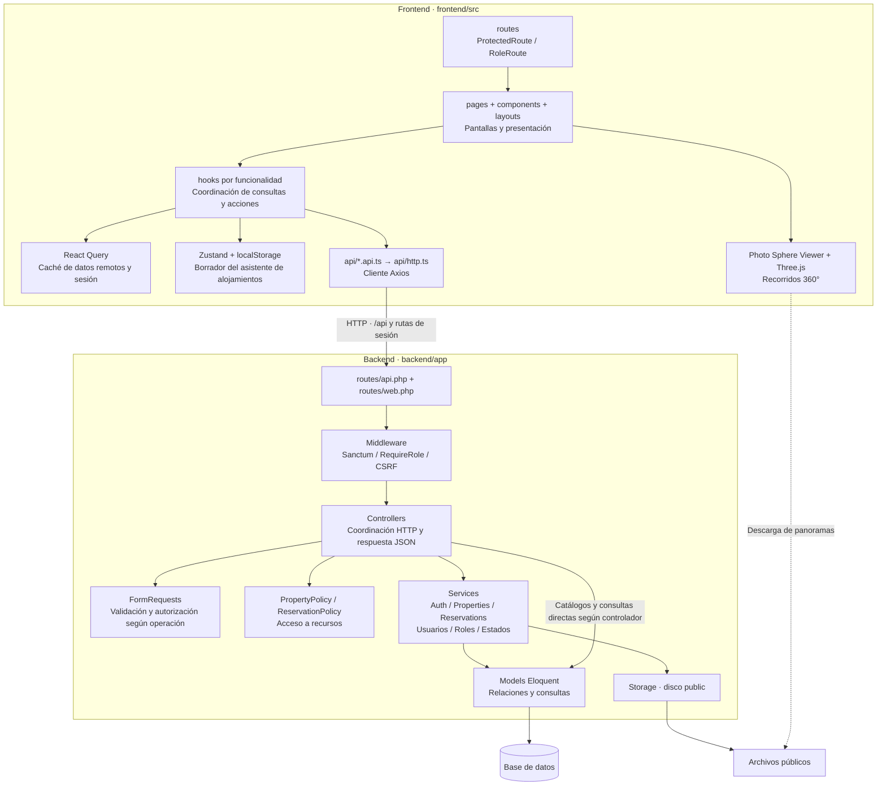
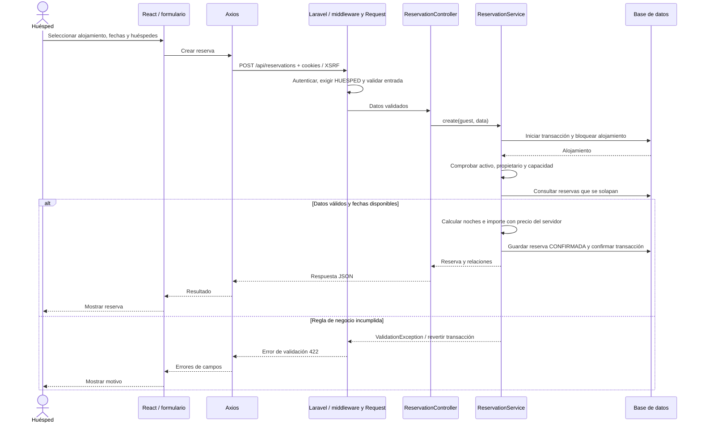
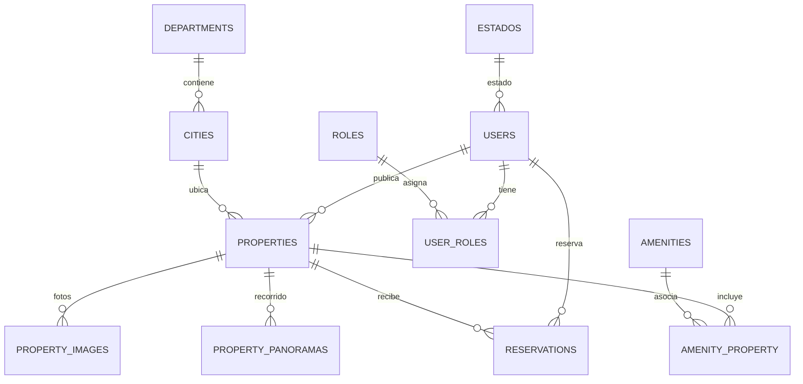

# ComfortStyle · Arquitectura de software

Estado observado: **5 de octubre de 2026**. Diagramas derivados del código y la configuración del repositorio.

[Ver diagrama visual en SVG](comfortstyle-arquitectura.svg). SVG vectorial, escalable y utilizable en presentaciones; abrir en el navegador para visualizarlo o imprimirlo como PDF.

El sistema combina una SPA React con un monolito Laravel organizado por capas. El frontend presenta alojamientos, reservas y recorridos virtuales; el backend controla autenticación, permisos, validación, reglas de negocio y persistencia. Los módulos pertenecen a una sola aplicación backend.

## Vista de contenedores

## Vista de componentes y responsabilidades

Las flechas de componentes representan dependencias y responsabilidades; el orden exacto de validación y autorización depende de la ruta y del FormRequest. Las consultas de catálogos y algunas lecturas usan modelos directamente: la capa de servicios no es obligatoria en todos los controladores.

## Flujo de creación de una reserva

`lockForUpdate()` expresa la estrategia de concurrencia implementada; su comportamiento depende del motor de base de datos. El diagrama describe el código, sin afirmar una prueba de concurrencia en producción.

## Modelo de dominio resumido

Vista de relaciones de negocio, no inventario completo de tablas técnicas ni especificación de nulabilidad de claves foráneas.

## Alcance y fuentes

- **Frontend:** `frontend/package.json`, `frontend/src/routes/router.tsx`, `frontend/src/api/http.ts`, `frontend/src/hooks/auth/useAuth.ts` y `frontend/src/store/propertySetupStore.ts`.
- **Backend:** `backend/composer.json`, `backend/bootstrap/app.php`, `backend/routes/api.php`, `backend/routes/web.php`, `backend/app/Services/`, `backend/app/Policies/` y `backend/app/Models/`.
- **Persistencia:** `backend/database/migrations/`, `backend/config/filesystems.php` y `backend/.env.example`. La configuración local selecciona PostgreSQL; no se reproducen credenciales.

No se encontró un panel React específico para SYSTEM_ADMIN; sus operaciones están disponibles en rutas de API protegidas. Los diagramas no atribuyen al sistema infraestructura desplegada, pasarela de pagos, CDN o servicios cloud. La configuración de S3 disponible en Laravel no acredita su uso: los servicios de imágenes y panoramas escriben explícitamente en el disco `public`.

El documento raíz `ARQUITECTURA.md` conserva propuestas de evolución. Esta carpeta registra la implementación observada y no sustituye ese documento.
